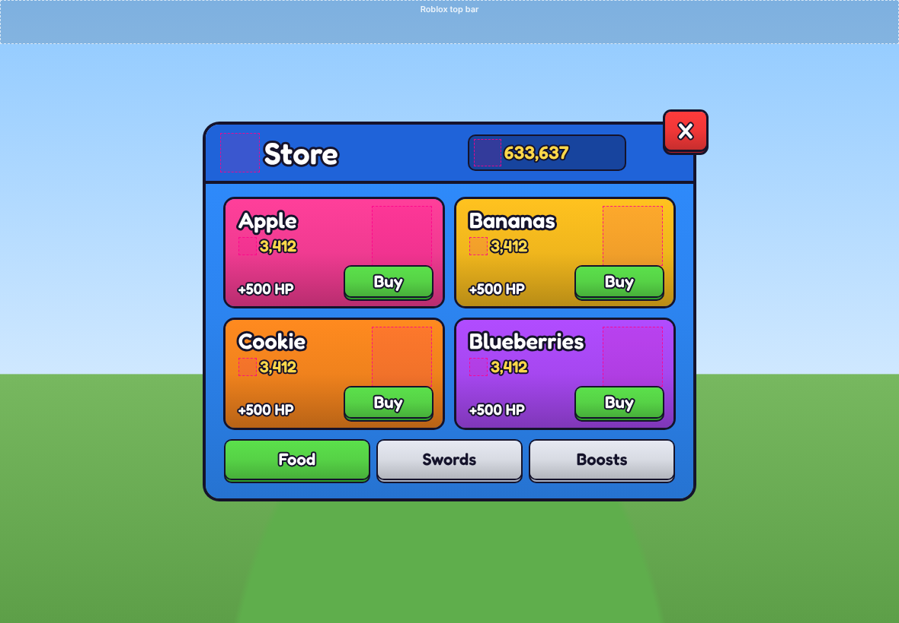

# roblox-studio

Roblox UI built as **real instances** (ScreenGui → Frame → UICorner/UIStroke/UIListLayout…),
stored as Rojo `.model.json` files. There are no scripts that build UI with `Instance.new`.



## Getting a UI into Studio

**No tools needed:** in Studio, right-click **StarterGui → Insert from File…** and pick a file from
[`build/`](build/) (for example `build/StoreUI.rbxmx`).

**With Rojo (live sync):** install [Rojo](https://rojo.space) and its Studio plugin, run
`rojo serve` in this folder, then click **Connect** in the plugin. Everything in
`src/StarterGui/` syncs into StarterGui.

Images are left empty (`Image = ""`) until you upload your icons. Paste each
`rbxassetid://…` into the matching `Icon…` / `Thumb` ImageLabel.

## Making new UI with Claude

The repo ships a Claude Code skill in [`.claude/skills/roblox-ui/`](.claude/skills/roblox-ui/SKILL.md).
Ask Claude for any screen ("make a daily rewards window", "add a side button bar with Shop, Pets,
Codes") and it will:

1. use the house style (bright simulator look with chunky outlines; theme in [`ui/theme.json`](ui/theme.json)),
2. write `src/StarterGui/<Name>.model.json`,
3. lint it against the anti-sloppy rules and theme,
4. render screenshots at phone, tablet and desktop sizes and fix what looks off,
5. build `build/<Name>.rbxmx` with Rojo.

Other style presets (clean dark, sci-fi HUD, cozy pastel, horror) are in
[`.claude/skills/roblox-ui/themes/`](.claude/skills/roblox-ui/themes/).

### Tool commands

```bash
S=.claude/skills/roblox-ui/scripts
node $S/format.mjs  src/StarterGui/StoreUI.model.json   # compact formatting
node $S/lint.mjs    src/StarterGui/StoreUI.model.json   # rules + theme check
node $S/preview.mjs src/StarterGui/StoreUI.model.json   # .ui-preview/*.html + PNGs (PNGs need Playwright)
node $S/build.mjs                                        # build/*.rbxmx (needs rojo)
```
